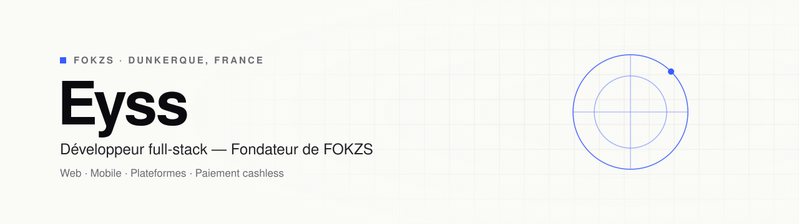

<picture>
  <source media="(prefers-color-scheme: dark)" srcset="./assets/banner-dark.svg">
  
</picture>

  <a href="https://fokzs.com"><b>fokzs.com</b></a>
  &nbsp;&nbsp;·&nbsp;&nbsp;
  <a href="mailto:contact@fokzs.com"><b>contact@fokzs.com</b></a>

 
## À propos
 
Je dirige **FOKZS**, un studio de développement qui conçoit, développe et maintient des sites, des applications mobiles et des plateformes métier pour les entreprises, du premier échange à la mise en production.
 
Au sein de FOKZS, je développe **T'Check It** : une solution de paiement cashless (NFC / QR code), de contrôle d'accès et de gestion de caisse pour les bars, clubs, festivals et associations sportives.
 
 
## Stack
 
<picture>
  <source media="(prefers-color-scheme: dark)" srcset="https://skillicons.dev/icons?i=ts,react,nextjs,vue,threejs,laravel,php,postgres,prisma,docker,linux,git&theme=dark">
  
</picture>
Mobile avec React Native & Expo · Paiement avec Stripe · Hébergement sur VPS (OVH, CloudPanel)
 
 
## Projets
 
<table>
  <tr>
    <td width="50%" valign="top">
      <h3>T'Check It PDA</h3>
      
Application mobile pour les caissiers et les opérateurs de contrôle d'accès : encaissement NFC / QR et validation des entrées.

      React Native · Expo · TypeScript
    </td>
    <td width="50%" valign="top">
      <h3>T'Check It Cup</h3>
      
Plateforme de gestion de tournois : inscriptions, tableaux, résultats et suivi des événements.

      Next.js · TypeScript
    </td>
  </tr>
  <tr>
    <td width="50%" valign="top">
      <h3>T'Check It Darts</h3>
      
Application web progressive de comptage de fléchettes en temps réel, pensée pour les bars et les compétitions.

      PWA · TypeScript
    </td>
    <td width="50%" valign="top">
      <h3>Espace client FOKZS</h3>
      
Tableau de bord client : état et disponibilité des services, demandes de support, devis et factures.

      Next.js · PostgreSQL · Prisma
    </td>
  </tr>
</table>
La plupart des projets clients sont hébergés dans des dépôts privés. Démonstrations disponibles sur demande.
 
 
## Travaillons ensemble
 
Un site, une application ou une solution de paiement cashless à mettre en place ?
Écrivez-moi à **[contact@fokzs.com](mailto:contact@fokzs.com)** ou rendez-vous sur **[fokzs.com](https://fokzs.com)**.
 
